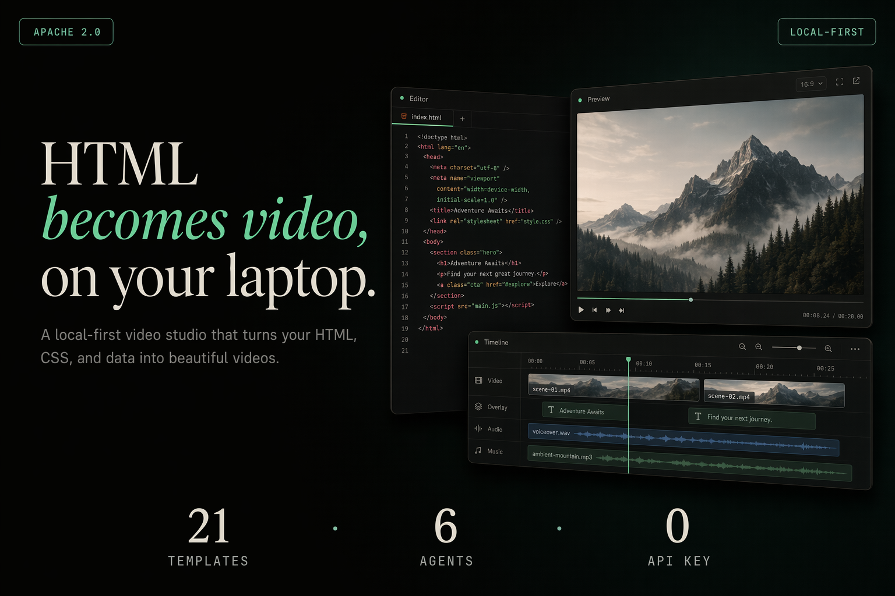

# html-video

<p align="center">
  
</p>

> **HTML becomes video — on your laptop.** Bring your local coding agent (Open Design · Windsurf CLI · Trae CLI · Claude Code · Cursor · Codex · Gemini · Grok · Qwen · OpenCode · Copilot · Aider · Hermes · or the Anthropic API). Describe a video, or **paste an article link / GitHub repo**, and the agent turns it into a multi-frame, fully animated video — then renders it to a real MP4 right on your machine. One agent loop, pluggable rendering engines, a curated template gallery, optional AI soundtrack. Apache-2.0, no per-render fees, no vendor lock-in.

<p align="center">
  <a href="LICENSE"></a>
  <a href="#supported-agents"></a>
  <a href="#showcase"></a>
  <a href="#turn-a-link-into-a-video"></a>
  <a href="#soundtrack"></a>
  <a href="#quick-start"></a>
</p>

<!-- Built by the team behind Open Design — these link to its community on purpose. -->
<p align="center">
  <a href="https://github.com/nexu-io/open-design#community"></a>
  <a href="https://x.com/nexudotio"></a>
  <a href="https://github.com/nexu-io/open-design"></a>
</p>

<p align="center">
  <b>An official project by the <a href="https://open-design.ai">Open Design</a> team</b> · <a href="https://open-design.ai">open-design.ai</a>
</p>

<p align="center"><b>English</b> · <a href="README.zh-CN.md">简体中文</a></p>

---

## Showcase

Every template below is a real, animated single-file HTML video — these are live renders, not mockups. Drop one in, let the agent fill it with your content, export to MP4.

<table>
<tr>
<td width="50%"></td>
<td width="50%"></td>
</tr>
<tr>
<td><b>frame-data-chart-nyt</b> · data-viz<br/>Editorial NYT-style animated line chart — headline, annotated data points, source line. For "the number went up" stories.</td>
<td><b>frame-glitch-title</b> · title card<br/>Chromatic-aberration glitch title with scanlines. For openers, drops, and "system online" energy.</td>
</tr>
<tr>
<td></td>
<td></td>
</tr>
<tr>
<td><b>frame-liquid-bg-hero</b> · hero<br/>Aurora liquid-gradient hero with a centered headline. For product reveals and bold statements.</td>
<td><b>frame-light-leak-cinema</b> · cinematic<br/>Warm film-grain + light-leak cinematic frame. For mood, brand films, "a quiet year" storytelling.</td>
</tr>
<tr>
<td></td>
<td></td>
</tr>
<tr>
<td><b>vfx-text-cursor</b> · VFX<br/>Typewriter text with a blinking terminal cursor. For code-style reveals and CLI demos.</td>
<td><b>frame-logo-outro</b> · outro<br/>Clean animated logo end card. For sign-offs and brand stamps at the end of any video.</td>
</tr>
</table>

…and 22 more, including native Remotion data charts, multi-scene product promos, kinetic type, Swiss-grid and modular data cards, decision-tree explainers, soft-radar organic motion, and warm-grain editorial. Browse all 28 live in the studio gallery.

---

## Why this exists

HTML→Video is a real category — but every engine is opinionated, and each wants you to learn *its* authoring model:

| Engine | Paradigm | Tradeoff | In html-video |
|---|---|---|---|
| [Hyperframes](https://github.com/heygen-com/hyperframes) | HTML + CSS + GSAP, agent-skill driven | Single rendering paradigm | ✅ **Shipped** — the default engine; renders real MP4 via headless Chromium + ffmpeg |
| [Remotion](https://www.remotion.dev/) | React components | Source-available, paid above 4 devs | ✅ **Shipped** — opt-in per-frame enhance; 5 native charts + KPI pulse |
| [Motion Canvas](https://github.com/motion-canvas/motion-canvas) · [Revideo](https://github.com/redotvideo/revideo) | TypeScript generators on canvas | Best for explainers, code-first | 🗺️ Planned |
| [Manim](https://github.com/3b1b/manim) & friends | Math / 3D first | Niche | 🗺️ Researching |

Picking the right engine per use case, learning each model, and stitching them into one workflow costs real engineering time. Most teams pick one and live with its limits.

**html-video is the meta-layer that sits above all of them.** You talk to your agent; it picks the engine, picks the template, fills in your content, and renders the video. The engine is an implementation detail behind a single adapter interface — one `render(input, ctx)` contract that any backend can satisfy. Add a new engine and every template, every agent, and the whole studio workflow get it for free. No new DSL to learn, no rewrite when you switch engines.

The same idea powers [Open Design](https://github.com/nexu-io/open-design) in the *design* space — an agent meta-layer over many tools. html-video is the *motion* counterpart from the same team.

> **Status:** the pluggable-engine architecture is in place. **Hyperframes** is the default base (headless Chromium + ffmpeg → real MP4). **Remotion** is available as a user-opt-in per-frame enhancement for native data charts; mixed-engine videos are concatenated with ffmpeg's concat filter. Motion Canvas / Revideo and Manim remain on the roadmap. The "In html-video" column above is the single source of truth for what's actually runnable today.

---

## At a glance

| | |
|---|---|
| **Coding agents (14)** | Open Design (Vela) · Windsurf CLI · Trae CLI · Claude Code · Cursor Agent · Codex CLI · Gemini CLI · Grok Build · Qwen Code · OpenCode · GitHub Copilot CLI · Aider · Hermes · Anthropic Messages API — auto-detected on your `PATH`, switchable from the top bar. |
| **Real MP4 render** | Headless Chromium records the animated HTML and ffmpeg encodes it (libx264) — locally, no cloud render, no per-clip fee. |
| **Article / repo → video** | Paste a URL or GitHub repo; the studio fetches it server-side (handles WeChat 公众号 articles) and builds the video from the real content. |
| **28 templates** | Curated, license-clean patterns: data viz, product promos, social shorts, explainers, kinetic type, transitions — previewed live in the gallery. |
| **Multi-frame storyboards** | A content-graph drives multi-scene videos; edit per-frame text inline, reorder, re-render. |
| **AI soundtrack** | Optional background music + narration via MiniMax, mixed into the MP4 at export. |
| **Studio + CLI** | A local browser studio *and* a scriptable `html-video` CLI. |
| **License** | Apache-2.0 — no per-render fees, no seat caps, no contributor agreements. |

---

## How it works

One sentence (or one link) goes in; a real MP4 comes out. The pipeline is the same whether you start from a prompt, an article, or a repo:

```
  prompt / link / repo
        │
        ▼
  ① source fetch        studio pulls the URL or repo server-side, flattens it to Markdown
        │
        ▼
  ② agent loop          your agent reads the material + the picked template's style and emits
        │               a content-graph (the storyboard) + one HTML block per frame
        ▼
  ③ content-graph       multi-frame IR — nodes (entity / data / text) + edges (sequence /
        │               dependency / contrast); topo-sorted into frame order & timing
        ▼
  ④ per-frame HTML      each node becomes a self-contained animated HTML frame on disk
        │
        ▼
  ⑤ Hyperframes render  headless Chromium loads each frame, records it (auto-extending to
        │               cover the frame's own animation), → webm per frame
        ▼
  ⑥ ffmpeg              each webm → mp4 (libx264), then concat into one video;
        │               optional MiniMax music + narration mixed in
        ▼
      your.mp4
```

Steps ②–④ are where the "meta-layer" lives: the agent decides the storyboard and the engine decides how to draw it, and neither leaks into the other. Step ⑤ is engine-specific — swapping in Remotion or Motion Canvas later replaces only that box, leaving the storyboard and the agent loop untouched. Everything runs on your machine; the only network calls are the optional source fetch and the optional soundtrack.

Single-frame videos take a fast path that skips the content-graph — one template, one HTML, straight to render.

---

## Turn a link into a video

This is what most people reach for: hand your agent a link, get a video back. The agents run as local CLIs with no network access of their own, so the studio fetches the source **server-side** and feeds the real content into the generation prompt — no copy-pasting article bodies, and pages behind a login-free server render (like WeChat 公众号) just work.

```
You:   做一个解读视频  https://mp.weixin.qq.com/s/…
Agent: 好，我读完了《用嘴剪视频的时代来了？…》这篇文章 — 这就基于它生成。下一步选风格。
→      multi-frame explainer, built from the article's actual points
```

- **Web article** → fetched and flattened to Markdown. Server-rendered pages like **WeChat 公众号** articles work out of the box.
- **GitHub repo** → description, top-level structure, and README pulled via the public API — great for "explain this open-source project" videos.
- **Just a prompt** → describe the topic and the agent writes the content from scratch.

Whatever the source, it becomes the material the video is actually built from — not decoration around a canned template. The agent reads the fetched content, decides how many scenes it needs, and writes a **content-graph storyboard**: the key points become frames, the relationships between them (this follows that, this contrasts with that) become edges, and the picked template's visual style is applied per frame. So a 1,500-word article turns into a paced multi-scene explainer whose every line traces back to something in the source, and a repo turns into a structured walkthrough of what the project actually is.

---

## Quick start

### Prerequisites

| Requirement | Minimum | Check |
|---|---|---|
| **Node.js** | 20+ | `node --version` |
| **pnpm** | 9+ | `pnpm --version` |
| **ffmpeg** | Any recent | `ffmpeg -version` |
| **Chromium** (or Playwright browsers) | — | `npx playwright install chromium` |

The default rendering engine records animated HTML in a headless Chromium browser, then uses ffmpeg (libx264) to encode MP4. Install Playwright's Chromium if you don't have a system install:

```bash
npx playwright install chromium
```

### Install & run

```bash
pnpm install
pnpm build
pnpm doctor          # or: node packages/cli/dist/bin.js doctor
node packages/cli/dist/bin.js studio    # opens the studio at http://127.0.0.1:3071
```

In the studio: pick a template (or just describe a video / paste a link), chat with your agent, edit per-frame text, add a soundtrack, and export MP4.

### For coding agents

Point your agent at **[`SKILL.md`](SKILL.md)** — the CLI contract for single-frame and multi-frame workflows. Full command reference: [`packages/cli/README.md`](packages/cli/README.md). Agents call **`html-video` commands only** (never import npm packages directly). JSON envelope: `{ "status": "ok", ... }`; project lifecycle is **`project_status`**, not `status`.

Quick CLI path (multi-frame):

```bash
html-video project-create --name "Demo" --intent "3-frame explainer"
html-video project-set-graph $ID --graph-file storyboard.json
html-video project-write-frame $ID --node intro --html-file frames/intro.html
html-video project-render $ID --output out.mp4 --stream-progress
```

Maintainers: `pnpm verify` runs build, typecheck, lint, template audit, tests, and fast smoke.

### CLI utilities

```bash
html-video doctor
html-video search-templates --intent "github stars race" --top 3
html-video project-list
pnpm validate-templates    # RFC-07 provenance + manifest audit (28 templates)
```

---

## Supported agents

Auto-detected on your `PATH`; switch the active one from the studio's top bar. The studio leads with **Open Design (Vela)** — one login, many models, lower cost — then falls back to the first *available* agent so a fresh project always has a working backend.

| Agent | Detection | Invocation |
|---|---|---|
| **Open Design (Vela)** | `vela` / bundled in the Open Design app | ACP over stdio — one login in Open Design, pick any model |
| **Windsurf CLI** | `windsurf` | `windsurf --yolo`, ACP over stdio |
| **Trae CLI** | `traecli` | `traecli acp serve --yolo`, ACP over stdio |
| **Claude Code** | `claude` | `claude --print`, prompt via stdin |
| **Cursor Agent** | `cursor-agent` | `cursor-agent --print` |
| **Codex CLI** | `codex` | `codex exec`, prompt via stdin |
| **Hermes** | `hermes` | Hermes ACP CLI |
| **Gemini CLI** | `gemini` | Prompt via stdin |
| **Grok Build** | `grok` | `grok -p <prompt>` |
| **Qwen Code** | `qwen` | Prompt via stdin |
| **OpenCode** | `opencode` | `opencode run`, prompt via stdin |
| **GitHub Copilot CLI** | `copilot` | `copilot --allow-all-tools`, prompt via stdin |
| **Aider** | `aider` | `aider --message <prompt>` |
| **Anthropic API** | BYOK | Direct Messages API — works with no CLI installed |

Nothing installed? Set an Anthropic key and the studio talks to the Messages API directly.

---

## Soundtrack

Give the finished video a voice. In **Settings → Audio**, add a MiniMax API key, then in the per-project **Soundtrack** panel:

- **Background music** — describe a mood (`calm cinematic ambient, slow build`); MiniMax generates an instrumental track.
- **Narration** — type a script; MiniMax reads it (TTS).

Both are mixed into the exported MP4 (music ducked under the voice, optional fade-in/out) via ffmpeg. No key configured? The rest of the studio works unchanged.

---

## Template gallery

The 28 templates aren't a random grab-bag — each one is a self-contained, agent-readable unit described by a `template.html-video.yaml` manifest the studio scans at startup. A manifest carries everything the agent needs to pick and drive the template without opening the HTML:

- **What it's for** — `category`, `tags`, and a `best_for` list (e.g. *"Corporate slide"*, *"Minimal report card"*) that `search-templates` matches your intent against.
- **What it outputs** — supported resolutions, aspect ratios, fps, duration bounds, whether it has an alpha channel or audio.
- **What goes in** — an `inputs` JSON schema, so the agent knows exactly which text/data slots to fill.
- **License provenance** — an SPDX id plus explicit `attribution_required` / `redistribution_allowed` / `commercial_use` flags, and an `assets_attribution` block pointing at the upstream source URL.

That last part is deliberate. Every template is **license-clean by construction**: forks carry their original license, the repo-root [`ATTRIBUTIONS.md`](ATTRIBUTIONS.md) records each upstream and SPDX, and nothing without a clear permissive license ships. So you can put any of them in commercial work without an audit. Templates span data viz (NYT-style charts, Swiss/Vignelli grids, native Remotion charts), titles & VFX (glitch, kinetic type, typewriter cursor), heroes & cinematics (liquid gradients, light-leak, warm grain), product promos (15s / 30s multi-scene), and explainer scaffolds (decision trees) — and the format is open, so community templates drop in the same way.

---

## Architecture

```
packages/
├── core/                  Project / Asset / ContentGraph types, registries, orchestrator,
│                          MiniMax provider + ffmpeg audio mux
├── content-graph/         Multi-frame storyboard IR (nodes + edges, topo-sort)
│ runtime/               Agent runtime — detect / spawn / stream
│                          (Open Design/Vela · Windsurf CLI · Trae CLI · Claude · Cursor · Codex · Gemini · Grok · Qwen · OpenCode · Copilot · Aider · Hermes · Anthropic API)
├── adapter-hyperframes/   Hyperframes engine adapter — real render via Chromium + ffmpeg
├── cli/                   `html-video` command + the studio HTTP server + source fetching
└── project-studio/        Browser studio UI (chat, template gallery, frames, soundtrack, export)
templates/                 28 curated, license-clean video templates
research/                  RFCs (engine adapter / template metadata / agent skill / content-graph)
```

---

## Roadmap

- [x] Engine adapter spec — one interface, N backends
- [x] Template metadata format — license-first, agent-readable
- [x] Multi-frame storyboard workflow (content-graph)
- [x] Studio: live template gallery, agent switcher, per-frame text editing
- [x] Source material: article / GitHub-repo → video
- [x] AI soundtrack (MiniMax music + narration), mixed at export
- [x] Real MP4 render — Hyperframes engine via headless Chromium + ffmpeg
- [x] Agent model selection — Open Design (Vela) backend, live model catalog
- [x] Remotion adapter — bridge + 5 native charts + KPI pulse; per-frame enhance (CLI + Studio)
- [x] Agent skill — repo `SKILL.md` + installable Claude Code / Cursor copies (`scripts/install-agent-skill.sh`)
- [ ] Adapters for Motion Canvas / Revideo
- [ ] Template marketplace

---

## References & lineage

| Project | Role here |
|---|---|
| [Open Design](https://github.com/nexu-io/open-design) | Sister project — the design-agent meta-layer; same team, shared philosophy |
| [HTML Anything](https://github.com/nexu-io/html-anything) | Sister project — HTML for *static* deliverables; html-video is the *motion* side |
| [Hyperframes](https://github.com/heygen-com/hyperframes) | The shipped engine adapter; the HTML+CSS+GSAP rendering paradigm and the source of several Apache-2.0 templates |

Template upstream mapping: [`ATTRIBUTIONS.md`](ATTRIBUTIONS.md) · agent CLI contract: [`SKILL.md`](SKILL.md)

## License

[Apache-2.0](LICENSE)

## Built by

[nexu-io](https://github.com/nexu-io) — the team behind [Open Design](https://github.com/nexu-io/open-design). Join the [Discord](https://github.com/nexu-io/open-design#community) · follow [@nexudotio](https://x.com/nexudotio).
